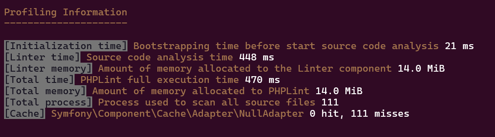

# Migration Guide

If you're already a user of previous version of PHPLint, you probably want to use it in the same way.

## Begin by define the `mode`

- Define globally or locally the `PLINT_MODE` environment variable and set its value to `legacy`
- You can also define it on the `phplint` binary invocation.

For example:

```shell
PLINT_MODE=legacy phplint
```

> [!WARNING]
> 1. When Symfony Console `-v, --verbose` flag is provided, the current configuration settings is displayed on same format as 9.7 version.
> 2. Difference came from the profiling information printed between 9.7 and 9.8 versions

> [!CAUTION]
> If you use a YAML configuration file, three directives were renamed to avoid conflicts :
>
> - `extensions` should be named `file-extensions`
> - `output` should be named `output-file`
> - `format` should be named `output-format`
>
> If you still used them, you'll get deprecations displayed, on standard output and/or through the logger

> [!IMPORTANT]
> If you use your own logger or never use it (`PLINT_LOGGER='Psr\Log\NullLogger'`), you won't be notified of any deprecations.

## Use or Not the `profile_manager`

With PHPLint 9.7, the profiler was always displayed. There is no capacity to disable it !

For example:


With PHPLint 9.8, we have now ability to disable the profiler, even if the `legacy` mode is activated.

For example:

```shell
PLINT_MODE=legacy phplint /path/to/source/code --profile never
```

By default, the profiler is in `auto` mode, and print all information.

For example:


